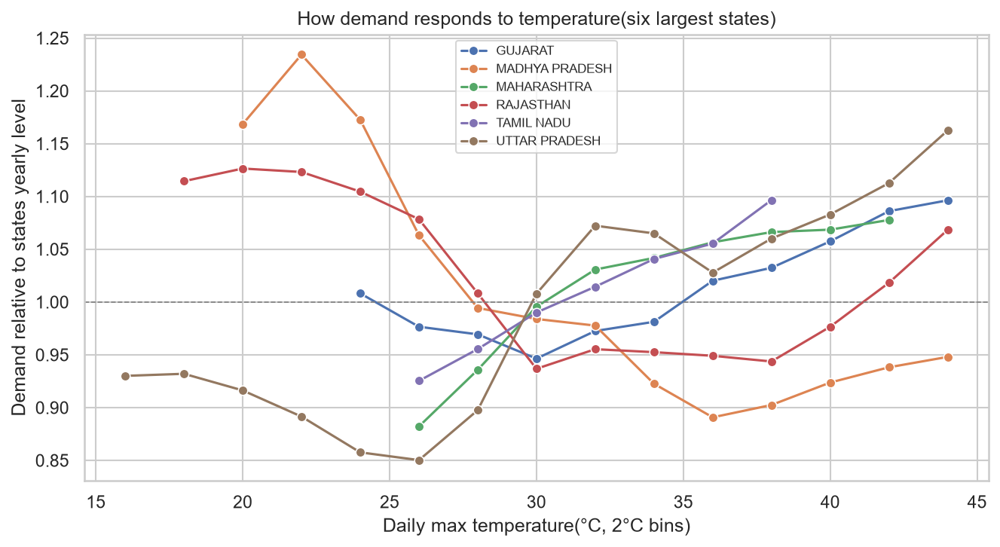
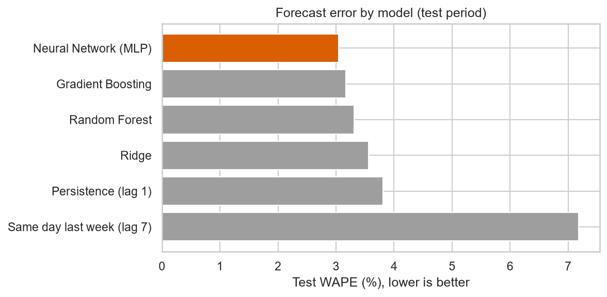
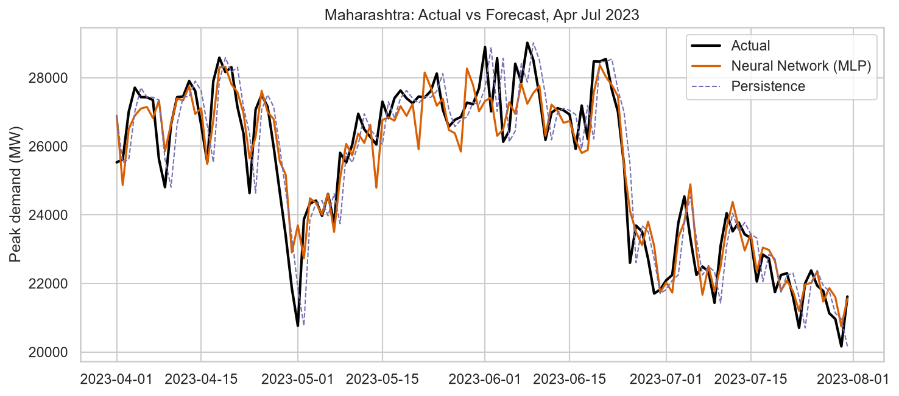
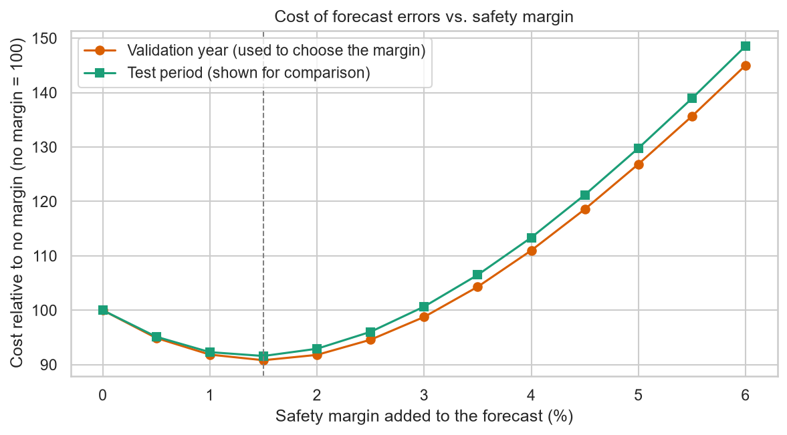

# India Heatwaves and Peak Electricity Demand

Forecasting state-level peak electricity demand in India, testing whether weather improves the forecast, and translating forecast errors and a heatwave scenario into rupees.

**Business question:** As heatwaves push up electricity demand, can peak demand be forecast well enough to plan purchases, and what does a forecast error cost?

## Key results

| Model | Test WAPE (all days) | Summer (Apr to Jun) | Hot days (tmax >= 40°C) |
|---|---|---|---|
| Neural network (MLP) | **3.04%** | 3.25% | 2.74% |
| Gradient boosting | 3.17% | 3.47% | 2.91% |
| Random Forest | 3.31% | 3.63% | 3.02% |
| Ridge regression | 3.56% | 3.80% | 3.17% |
| Persistence (copy yesterday) | 3.81% | 4.04% | 3.30% |
| Same day last week | 7.18% | 8.48% | 7.42% |

WAPE is total absolute error divided by total demand (lower is better). Test period: Jan 2023 to Apr 2024.

- **Forecasting:** the best model cuts error by about 20% against the persistence baseline. The top three models are within about 0.3 percentage points of each other.
- **Weather helps modestly:** removing weather features raised gradient boosting's error from 3.17% to 3.25% overall and from 2.91% to 3.12% on hot days. Recent demand (yesterday and the 7-day average) accounts for about 80% of the model's reliance.
- **Financial impact:** under the stated assumptions, gradient boosting saves about Rs 554 crore (15.8%) over persistence across the 16-month test period. A 1.5% safety margin on the forecast saves a further Rs 249 crore, because running short costs more than having a surplus.
- **Heatwave scenario:** a +2°C shift adds about 0.46% to summer peak demand (about 449 GWh, Rs 319 to 449 crore). Rajasthan and Punjab are the most exposed states. This is a conservative estimate, because the model is nearly flat at very high temperatures.

## Charts






## Data

Daily state-level data for 28 Indian states, 8 Jan 2014 to 28 Apr 2024: peak demand met (MW), peak demand unmet (MW), max and min temperature, humidity and heat index.

**Source and licence:** [https://www.kaggle.com/datasets/sanaarizvi/india-heatwave-and-power-stress-dataset-20142024]

## Approach

**1. Cleaning and exploration**
- 105,980 raw rows reduced to 103,388 clean rows. Steps: collapsed 4,368 duplicate state-date copies, rebuilt a full daily calendar, filled gaps of up to 3 days only, set impossible values to missing, and dropped Andhra Pradesh and Telangana for 2014 because of the state split.
- Target: peak demand = demand met + unmet demand.
- Findings: demand grew about 49% from 2015 to 2023; the temperature response differs by state (Uttar Pradesh and Gujarat rise in the heat, Madhya Pradesh does not); April 2020 shows a lockdown dip; the share of state-days with unmet demand fell from about 64% in 2014 to about 6% in 2022 and 2023.

**2. Features and models**
- 51 leakage-free features: lagged demand, rolling averages, a backward-looking demand level, temperature anomaly, heatwave streak, and calendar flags.
- Demand is modelled as a ratio to each state's recent level, so that growth over time does not break the models.
- Time-based split: train to 2021, validate on 2022, test from 2023. The COVID-19 lockdown window is excluded from training (a robustness check shows it makes no difference).
- Models: persistence and last-week baselines, Ridge, Random Forest, gradient boosting, and a neural network (MLP).
- Analysis: weather ablation, permutation importance, and a temperature partial-dependence plot.

**3. Financial impact**
- Forecast error is converted to rupees with separate costs for under-forecasting (top-up purchases) and over-forecasting (resold surplus).
- A sensitivity grid varies both costs. The model's saving over persistence stays positive in every combination (about Rs 173 to 1,360 crore).
- A safety margin is chosen on the validation year and applied once to the test period.
- A heatwave scenario re-forecasts the test period with temperatures raised by 1 to 4°C.

## Financial assumptions

| Assumption | Value | Basis |
|---|---|---|
| Planned (day-ahead) price | Rs 7,100/MWh | Average day-ahead exchange price was about Rs 7.14/kWh in 2023 ([CERC market data](https://cercind.gov.in/2025/draft_reg/Comments_8-SM-2024/PXIL.pdf)) |
| Top-up price for a shortfall | Rs 10,000/MWh | Exchange price ceiling of Rs 10/kWh from April 2023 ([CERC order 5/SM/2023](https://cercind.gov.in/2023/orders/5-SM-2023.pdf)) |
| Loss on resold surplus | 25% of planned price | Assumption, not sourced |
| Peak hours per day | 4 hours | Assumption, not sourced |

The rupee totals are illustrative. Comparisons between options and the sensitivity grid are more reliable than the absolute amounts.

## Limitations

- The model uses actual same-day weather. Real forecasts would use weather forecasts, so real errors would be larger.
- The test period contains one full summer (2023) plus Jan to Apr 2024, so heatwave conclusions rest on limited extreme-heat days.
- Peak MW is converted to energy with a fixed number of peak hours. Load-shedding losses, penalties and contracts are not modelled.
- The heatwave scenario is a statistical extrapolation from 2014 to 2024 data, not an engineering model. It ignores growth in air-conditioner use and changes in past demand.
- Single random seed and light tuning, so small differences between models are not meaningful.
- The data has no Delhi or other union territories, and no rainfall or wind.


## How to run
1. Install the tools: `pip install -r requirements.txt`
2. Download the dataset from (https://www.kaggle.com/datasets/sanaarizvi/india-heatwave-and-power-stress-dataset-20142024) and save it as
   `data/final_dataset.csv`
3. Open `notebooks/India_Heatwave_analysis_2014_2025.ipynb` and and choose **Kernel → Restart & Run All**.

## Repository structure

```
├── README.md
├── requirements.txt
├── data/
│   └── final_dataset.csv
├── notebooks/
│   └── India_Heatwave_analysis_2014_2025.ipynb
└── images/
    └── temperature_response.png
    └── model_comparison.png
    └── actual_vs_forecast.png
    └── safety_margin.png
```

## Possible next steps

- Hourly demand data to replace the fixed peak-hours assumption.
- Quantile forecasts to set the safety margin directly.
- A dedicated temperature-response model without demand lags for the heatwave scenario.
- Adding an LSTM and a holiday and festival calendar.
